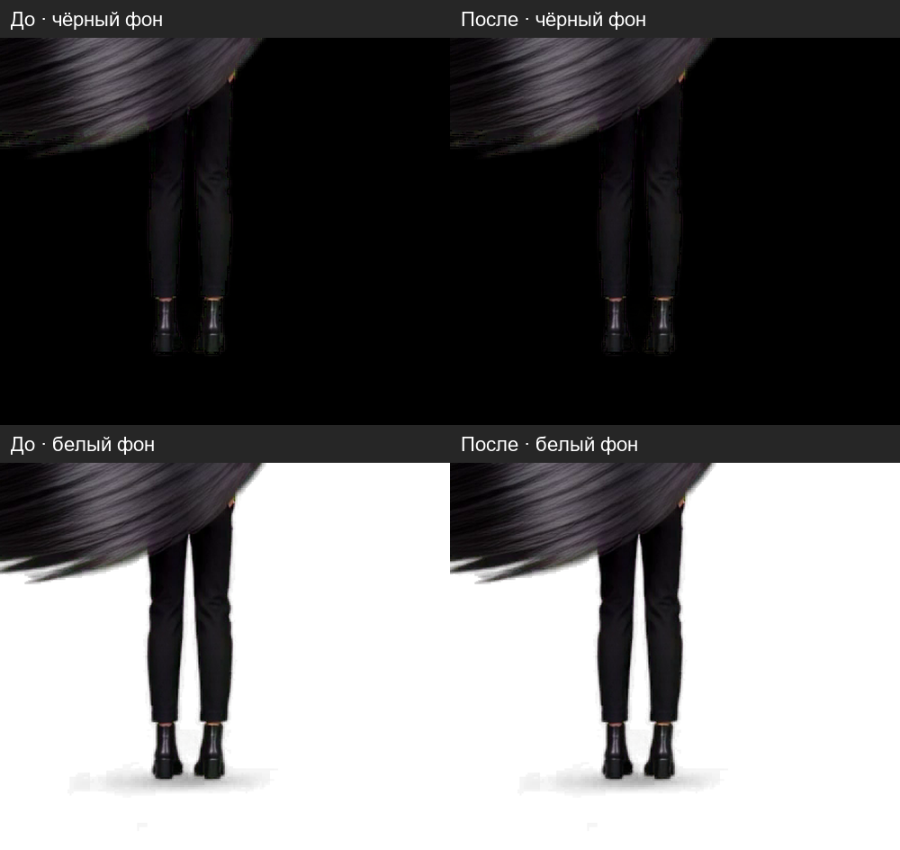
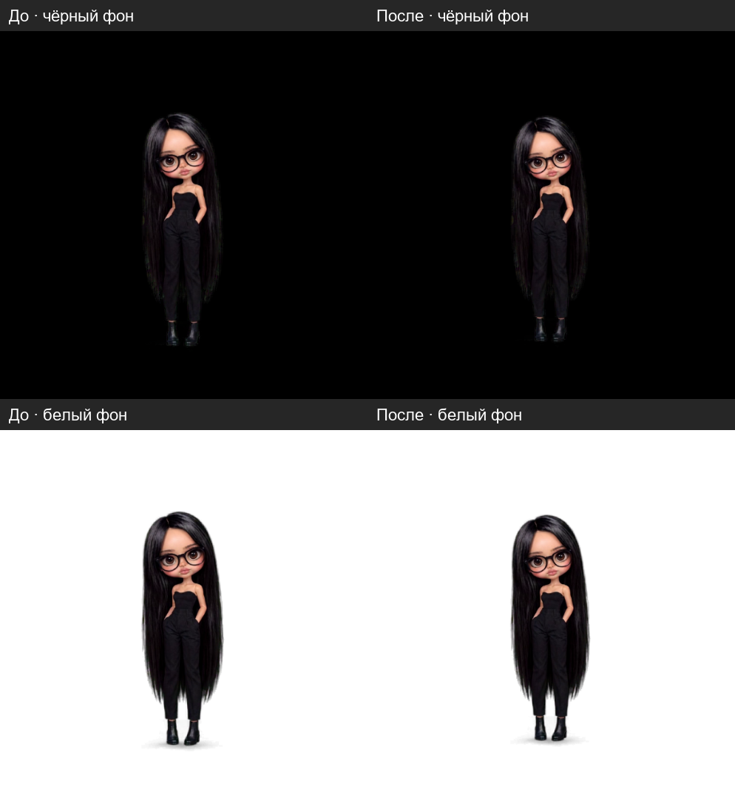

# Брюнетка в очках

[Скачать `.pet`](https://github.com/GamoffVad/Sputnik/releases/download/pets-2026-11-22/black-haired-doll.pet) · [Манифест](package-manifest.json) · [Тема](theme.json) · [Проверка исправления](repair.json)

**10 прозрачных анимаций, 970 кадров, 832×832, 24 кадра/с.** Все исходные кадры движений сохранены.

Исправлен скачок размера между движениями: масштаб и положение опоры выровнены для каждого клипа целиком. В проверке при размере окна 496,8 логических пикселя разброс высоты уменьшился с 10–16 до 1–2 физических пикселей при DPI 100% и 150%. Покадровое движение, прыжки и наклоны сохранены.

Зелёная примесь на кончиках волос удалена. Альфа-канал всех исходных пикселей и красный/синий каналы сохранены побайтово: пряди не срезались, не утолщались и не заменялись. Полные PNG-кадры не уменьшались и не обрезались.

Общий референс и переходные подстановки отключены. В каждом движении остаётся 97 исходных кадров, без вставок, повторов или удаления при обработке.

[Видео «до/после» на чёрном и белом фоне](https://github.com/GamoffVad/Sputnik/releases/download/pets-2026-11-22/black-haired-doll-before-after.mp4)

Импорт: **Питомцы → плюс → файл `.pet` → Установить питомца**. Windows: Спутник 1.3.28.27 или новее. Формат поддерживается macOS 0.2.5; этот конкретный обновлённый пакет отдельно на Mac не проверялся.

1. Танец с поворотом
2. Быстрые шаги
3. Радостный прыжок
4. Дерзкий разворот
5. Ловит равновесие
6. Нетерпение
7. Взмах волос
8. Прислушивается
9. Собирается с духом
10. Наклон головы
