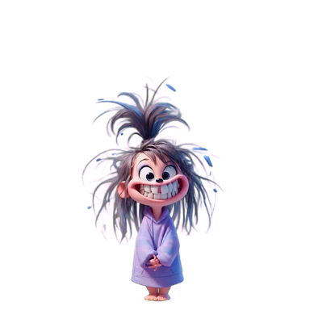

# Клякса

[Референс в исходном качестве, 384×384](reference.png) · [Метаданные](pet.json) · [Тема](theme.json) · [Манифест ресурсов](package-manifest.json)

Анимаций: 8. Встроен в установщик; отдельный пакет не требуется.

Опорные кадры: `keyframes/start.png` и `keyframes/end.png` — точные копии основного референса.
Описания движений: `animations/<id>/animation.json`. Рабочие материалы, обработанные кадры и готовые пакеты: `source/`, `renders/`, `exports/`.
