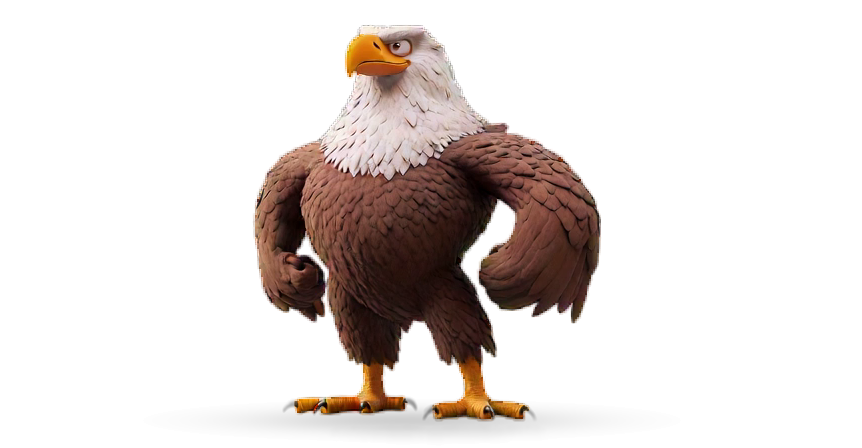
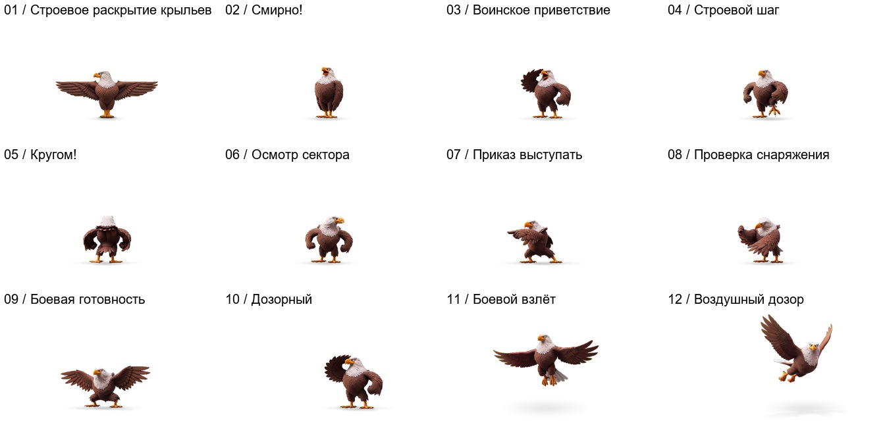

# Орёл

[Скачать `.pet`](https://github.com/GamoffVad/Sputnik/releases/download/pets-2026-11-22/military-eagle.pet) · [Превью на чёрном и белом фоне](https://github.com/GamoffVad/Sputnik/releases/download/pets-2026-11-22/military-eagle-preview.mp4) · [Манифест](package-manifest.json) · [Проверка](validation.json) · [SHA-256](SHA256SUMS.txt)

**12 прозрачных анимаций, 1164 кадра, 24 кадра/с.** По 97 исходных кадров на действие, около 4 секунд. Пакет: **187.2 МБ**.

Военизированный орёл со строевой выправкой, выразительными движениями и двумя вариантами полёта. В «Кругом» лапы поочерёдно поднимаются, переставляются и принимают вес; земля остаётся неподвижной.

Сохранены прозрачность, мягкая контактная тень во всех действиях, включая первую анимацию, и исходные пиксели персонажа. Удалены только пустые прозрачные поля. Постоянная область отображения каждого клипа согласует размер персонажа и точку опоры; движение внутри роликов не нормализуется покадрово. Проверены все 144 стыка при DPI 100% и 150%.

Воспроизведение не подменяет первый и последний кадры общим референсом и не смешивает анимации с неподвижным изображением. Все 1164 кадра сохранены.

Последние два полёта согласованы с небольшим обрезанием крайних кончиков крыльев в трёх кадрах каждого ролика. Эти версии сохранены без дополнительной генерации и дорисовки.

Для согласованного увеличенного размера нужен **Спутник для Windows 1.3.28.32 или новее**: [скачать приложение](https://github.com/GamoffVad/Sputnik/releases/tag/v1.3.28.32). В старых Windows-версиях и macOS 0.2.5 масштаб пакета 2.4 не поддерживается. Этот пакет отдельно на Mac не проверялся.

Импорт: **Питомцы → Добавить питомца → military-eagle.pet → Установить питомца**.

1. Строевое раскрытие крыльев
2. Смирно!
3. Воинское приветствие
4. Строевой шаг
5. Кругом!
6. Осмотр сектора
7. Приказ выступать
8. Проверка снаряжения
9. Боевая готовность
10. Дозорный
11. Боевой взлёт
12. Воздушный дозор
