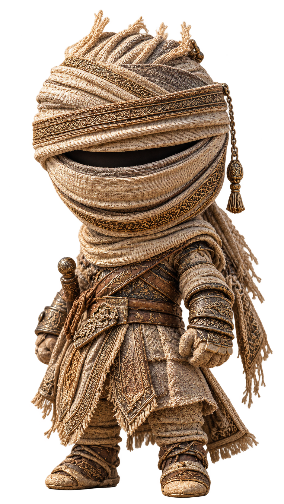

# Песчаный Дозорный

[Референс в исходном качестве, 941×1671](reference.png) · [Метаданные](pet.json) · [Тема](theme.json) · [Манифест ресурсов](package-manifest.json)

[Исходное изображение пользователя, 941×1671](reference-original.png) · [Горизонтальное отражение без изменения пикселей](reference-original-flipped.png). Кадр прежних ресурсов сохранён отдельно в `reference-legacy-frame.png`.

Анимаций: 15. Готовый локальный пакет: `exports/sand-watchman-clean.pet`. [Скачать .pet](https://github.com/GamoffVad/Sputnik/releases/download/pet-sand-watchman-v2/sand-watchman-clean.pet).

Пакет v3 использует отдельный общий кадр `neutral`: он отображается в начале и конце всех анимаций. Требуется Спутник 1.3.16 или новее.

Опорные кадры: `keyframes/start.png` и `keyframes/end.png` — точные копии основного референса.
Описания движений: `animations/<id>/animation.json`. Рабочие материалы, обработанные кадры и готовые пакеты: `source/`, `renders/`, `exports/`.
