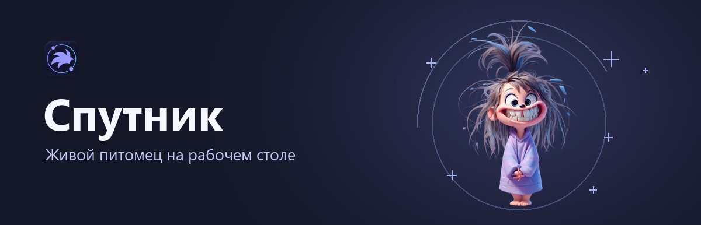

# Спутник



**Анимированный питомец для Windows и macOS.** Открывайте избранные сайты и программы, держите под рукой заметки и напоминания или пишите модели прямо из меню питомца.

## Скачать

| Платформа | Версия | Загрузка |
| --- | --- | --- |
| macOS 13+, Apple Silicon и Intel | 0.2.6, предварительная | [Скачать DMG](https://github.com/GamoffVad/Sputnik/releases/download/macos-v0.2.6/Sputnik-0.2.6-macOS-Universal.dmg) |
| Windows 10 / 11, x64 | 1.3.28.34 | [Установщик](https://github.com/GamoffVad/Sputnik/releases/download/v1.3.28.34/Sputnik-1.3.28.34-Windows-10-11-x64.exe) |
| Windows 7 SP1, x64 | 1.3.28.34 | [Установщик 64 бит](https://github.com/GamoffVad/Sputnik/releases/download/v1.3.28.34/Sputnik-1.3.28.34-Windows-7-x64.exe) |
| Windows 7 SP1, x86 | 1.3.28.34 | [Установщик 32 бита](https://github.com/GamoffVad/Sputnik/releases/download/v1.3.28.34/Sputnik-1.3.28.34-Windows-7-x86.exe) |

[Изменения Windows](docs/releases/1.3.28.34.md) · [Изменения macOS](docs/releases/macos-0.2.6.md) · [Архив выпусков](https://github.com/GamoffVad/Sputnik/releases)

Версии платформ нумеруются отдельно: Windows использует WPF, macOS — AppKit/WebKit. Выпуск macOS подписан ad hoc, без Developer ID и нотарификации Apple. [Установка и сборка macOS](macos/README.md).

## Установка

1. Скачайте файл `Sputnik-1.3.28.34-Windows-10-11-x64.exe` из [последнего выпуска](https://github.com/GamoffVad/Sputnik/releases/latest).
2. Запустите мастер, выберите папку и завершите установку. После скачивания интернет для установки не требуется.
3. Откройте **Спутник** из меню «Пуск». При первом запуске на рабочем столе появится **Клякса**.

Установщик включает .NET. Все окна Windows работают на WPF. Целевые системы — **Windows 10 22H2** и **Windows 11**, x64. Повторная установка обновляет существующую копию и сохраняет её путь. Заметки, настройки и ранее выбранный питомец сохраняются.

### Windows 7 SP1

Для Windows 7 SP1 предусмотрены отдельные офлайн-установщики на .NET Framework 4.8. [Инструкция по сборке и требования к системе](installer/README.md#windows-7-sp1).

В [релизах](https://github.com/GamoffVad/Sputnik/releases/latest) также доступна переносимая сборка.

<details>
<summary><strong>Если приложение не запускается</strong></summary>

- Кнопка **Журналы установки** в мастере открывает папку `%LOCALAPPDATA%\Sputnik.Desktop\logs`. Файл `.log` появляется при открытии мастера. Файл `.txt` с подробностями появляется после выхода из него.
- Ошибки запуска питомца и встроенных окон записываются отдельно в `%LOCALAPPDATA%\Sputnik\logs`.
- Если попытка запуска не удалась, приложите журнал и сообщите версию Windows, разрядность и текст ошибки. [Сообщить о проблеме](https://github.com/GamoffVad/Sputnik/issues/new)
- Заметки, настройки и библиотека импортированных питомцев хранятся в `%LOCALAPPDATA%\Sputnik`.

</details>

## Управление питомцем

Окна открываются рядом с выбранным пунктом меню. Размер можно менять у заметок — за маркер в правом нижнем углу; остальные окна имеют заданный размер. Чат и список сайтов оформлены компактно, действия представлены значками с подсказками. В **Внешний вид → Цвет новых заметок** можно выбрать **Автоцвет**: новые заметки чередуют пять цветов. [Изменения выпуска 1.3.28.34](docs/releases/1.3.28.34.md).

| Действие | Что открывается |
| --- | --- |
| Правый щелчок | Меню питомца |
| Один щелчок | Сферы с избранными сайтами и программами |
| Три щелчка | Быстрый чат |
| Ctrl + двойной щелчок | Показать или скрыть заметки |

- **Движения.** Анимации перемешиваются после каждого цикла. Можно выбрать конкретное движение или поставить воспроизведение на паузу. В списке видны все анимации.
- **Питомцы.** В установщике есть только Клякса. Остальные питомцы устанавливаются отдельно из файлов релиза рядом с установщиком. У Кляксы восемь анимаций, в том числе набор текста и нетерпеливое ожидание. Для своего питомца выберите **Питомцы → Добавить питомца**, откройте `.pet` и проверьте предпросмотр.
- **Заметки.** Цветные окна с форматированием, чек-листами и изображениями. Сохраняются содержимое, размер и положение каждого окна.
- **Напоминания.** Дата, время, повторы и откладывание. Напоминания появляются во время работы приложения, просроченные показываются при следующем запуске.
- **Внешний вид и чат.** Настраиваются тема, шрифт, размер питомца и сфер, горячие клавиши и подключение к модели. Для облачного чата нужен интернет. Параметры подключения находятся в разделе **Модель и API**.

## Питомцы

[Открыть актуальный каталог PET](PET/README.md) · [Скачать библиотеку](https://github.com/GamoffVad/Sputnik/releases/tag/pets-2026-11-22)

В каталоге 12 текущих питомцев, включая встроенную Кляксу и орла с 12 анимациями. Для каждого опубликован отдельный `.pet`, актуальные движения, тема, референсы и SHA-256. Рыцарь-дозорный удалён из текущего состава. Большие наборы требуют Windows-версии 1.3.28.27 или новее. Для согласованного увеличенного размера орла нужна версия 1.3.28.34 или новее.

## Сборка и материалы

Точный снимок текущих исходников Windows находится в [Windows-source.zip](https://github.com/GamoffVad/Sputnik/releases/download/v1.3.28.34/Sputnik-1.3.28.34-Windows-source.zip). Для его сборки нужен .NET SDK 10. В корне репозитория выполните:

```powershell
dotnet build -c Release
```

Исполняемый файл находится в `bin/Release/net10.0-windows/Sputnik.exe`.

- [Сборка офлайн-установщика](installer/README.md)
- [Спецификация приложения и формата .pet](SPEC.md)
- [Промпт подготовки и обработки анимаций питомцев](PET-ANIMATION-PROMPT.md)
- [Референсы, палитры и планы анимаций каждого питомца](PET/README.md)
- [Лицензии значков Lucide и Feather](wwwroot/assets/LUCIDE-LICENSE.txt)